# mmdustc Codex · 古卷风学术 PPT 模板

Claude 的暖色调 + 中世纪抄本的装饰语言：羊皮纸底、朱批红、金色双线边框与涡卷角花、罗马数字、铜版画风格插画、火漆印。面向 **AI 生成**：AI 只需按页型给出结构化内容，配色、字体、版心、断行由构建脚本保证。

本模板共 17 种页型，`demo/mmdustc-codex-demo.pptx` 按顺序完整展示全部页型（下方每种页型都附有 demo 截图）。

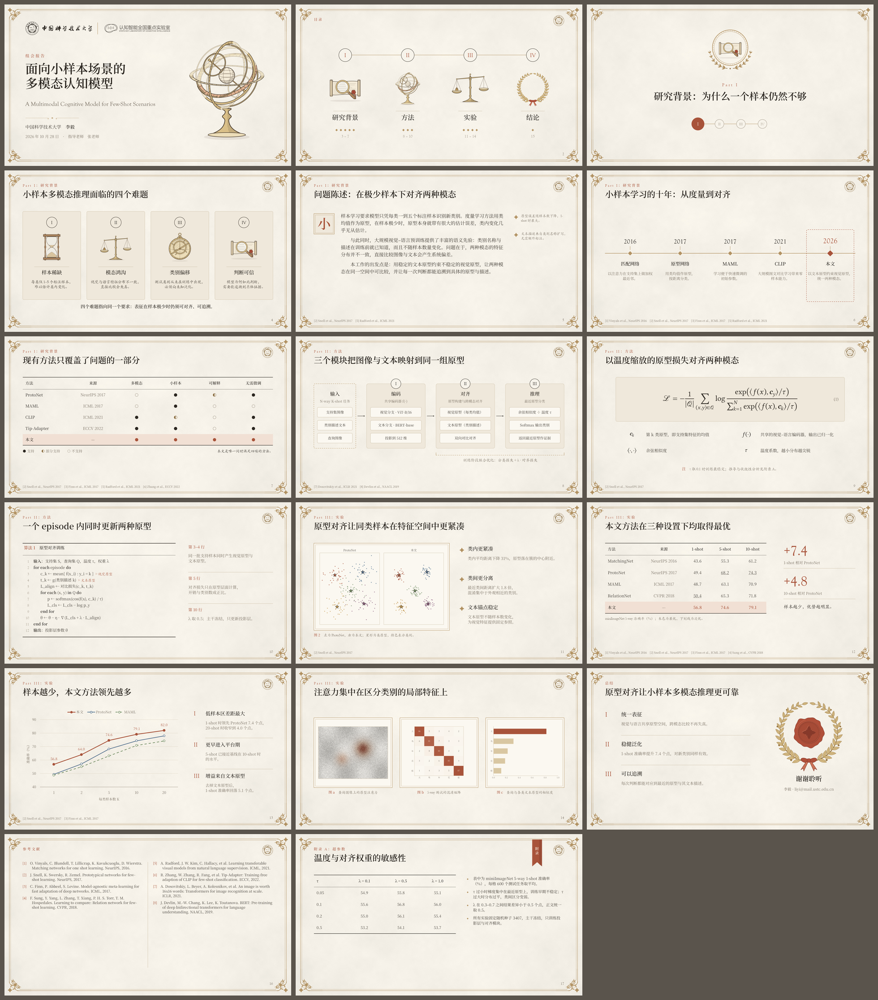

## 快速开始

```powershell
cd PPT
python build_demo.py                                   # 生成 demo/mmdustc-codex-demo.pptx
powershell -NoProfile -ExecutionPolicy Bypass -File tools/render.ps1 demo/mmdustc-codex-demo.pptx demo/preview
```

`render.ps1` 调用本机 PowerPoint 把每页导出为 `slide-NN.png`（真实字体、真实排版）；第 5 个参数给出 PDF 路径时同时导出 PDF。

自己写一份 PPT（在 `PPT` 目录下运行）：

```python
from codex.pages import Codex

cx = Codex(title='面向小样本场景的多模态认知模型', author='李毅')
cx.cover(kicker='组会报告', title_lines=['面向小样本场景的', '多模态认知模型'],
         title_en='A Multimodal Cognitive Model for Few-Shot Scenarios',
         affiliation='中国科学技术大学', presenter='李毅', date='2026 年 10 月 28 日', advisor='张老师')
cx.cards('Part I：研究背景', '小样本多模态推理面临的四个难题', [
    dict(art='hourglass', title='样本稀缺', text='每类仅 1–5 个标注样本，难以估计类内变化。'),
    dict(art='scales', title='模态鸿沟', text='视觉与语言特征分布不一致，直接比较会失真。'),
], takeaway='一句话结论。', refs='[2] Snell et al., NeurIPS 2017')
cx.save('out.pptx')
```

`build_demo.py` 就是全部 17 种页型的完整调用示例。

## 页面通用规则

- **页头**：每个正文页只有两行——朱色眉题 + 一句话标题。眉题写作 `Part I：研究背景`、`Part II：方法`；附录页写作 `附录 A：超参数`；目录页、参考文献页只有眉题。标题下面**不放副标题或导语**。
- **左下角只放参考文献**：通过每个页型的 `refs` 参数给出，一条字符串或一个列表（≤ 2 行），格式如 `[2] Snell et al., NeurIPS 2017`，编号与参考文献页一致。不放汇报人、日期或其他内容。
- **右下角**：自动页码。
- **右上角**：校徽（正文页自动放置）。

## 页型目录

字数按汉字计，英文与数字约两个字符算一个字；上限按真实字体宽度实测后留出余量。超出上限时应拆页或精简，不要缩小字号。

### 1 标题封面

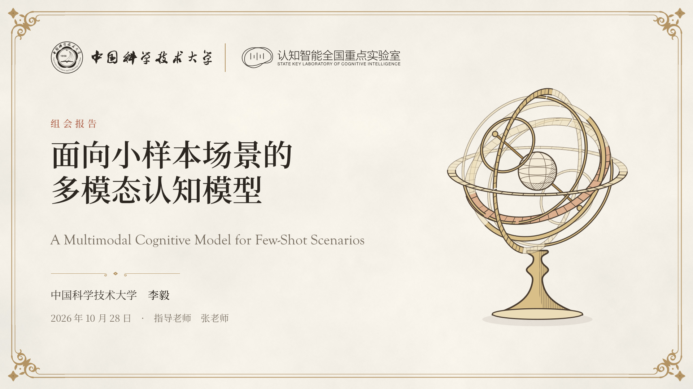

`cover(kicker, title_lines, title_en, affiliation, presenter, date, advisor, hero='armillary')`

- 左上角自动放置校徽、校名与认知智能全国重点实验室标识。
- `kicker` 只写报告类型，如“组会报告”。
- `title_lines`：中文主标题 1–2 行，每行 ≤ 12 字。
- `title_en`：中文标题的英文翻译，一行为宜（≤ 60 个字母），过长时自动在两行间均衡断开。
- 第三行为“单位　汇报人”，第四行为“日期 · 指导老师　姓名”。
- `hero`：右侧插画，默认浑天仪。

### 2 目录

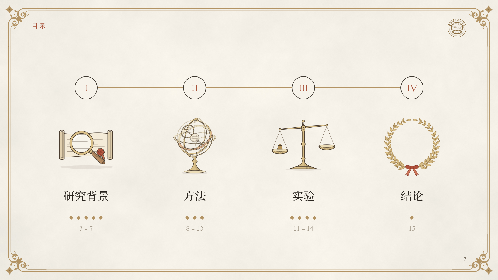

`toc(items)`

- 页面上的文字只有章节名：每章讲什么由插画暗示，篇幅由页数标记表达，不写说明句。
- `items`：3–5 章，每章 `dict(title, art, pages=(起, 止))`；`title` ≤ 6 字；`art` 取自插画库；每页一个金色菱形，下方为页码范围。
- 章节信息会被记住，章节过渡页自动沿用同一插画。

### 3 章节过渡

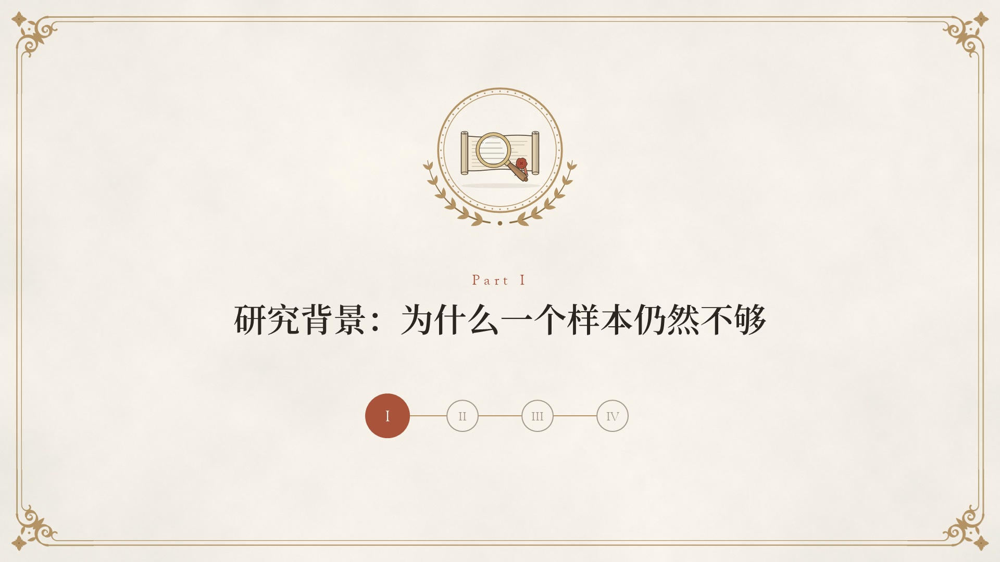

`section(index, title, art=None)`

- `index`：当前章（从 0 起），眉题自动生成为 `Part I`、`Part II`…
- `title` ≤ 20 字，是本页唯一的一句话。
- 徽章内放本章插画（默认取目录中的 `art`），与目录页对应。
- 底部进度珠不用文字表达位置：已讲完为金色实心，当前为朱色大圆，未讲为空心。

### 4 图文双栏

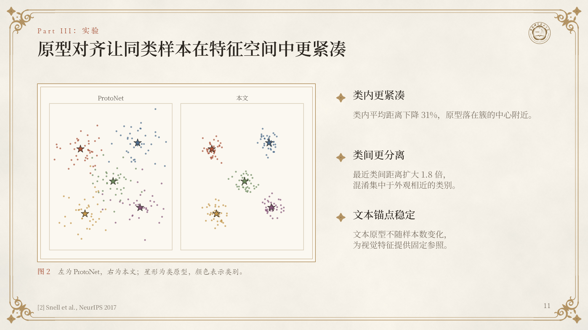

`figure_text(kicker, title, image, caption, points, label='图 1', refs=None)`

- `image`：任意比例图片，等比放入左侧图版（约 5:3 最佳）；`caption` ≤ 30 字。
- `points`：2–3 条 `(小标题, 说明)`，小标题 ≤ 12 字，说明 ≤ 44 字（两行，自动在标点处断行）。

### 5 方法架构

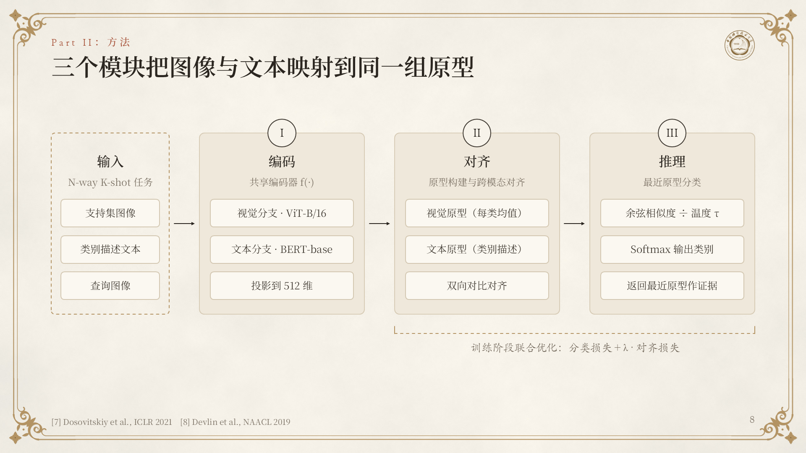

`architecture(kicker, title, inputs, stages, bracket=None, refs=None)`

- `inputs = (标题, [≤ 3 项], 说明)`，显示为虚线输入框。
- `stages`：2–4 个模块 `dict(title, sub, chips)`；`title` ≤ 4 字，`sub` ≤ 14 字，`chips` ≤ 3 项（3 个模块时每项 ≤ 12 字，4 个模块时 ≤ 8 字）。
- `bracket = (起, 止, 说明)`：横跨若干模块的虚线括注，说明 ≤ 30 字。

### 6 数学公式

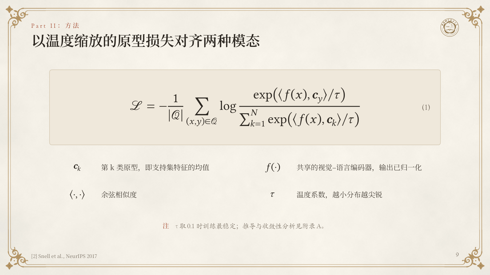

`formula(kicker, title, latex, eqno, legend, note=None, refs=None)`

- `latex`：一个行间公式（数学模式内容，不带 `$`，可用 `\bm{}`），XeLaTeX 排版后以矢量嵌入，过宽时自动缩小。
- `legend`：2–4 项 `(符号 LaTeX, 说明)`，说明 ≤ 18 字。
- `note` ≤ 48 字。

### 7 实验对比

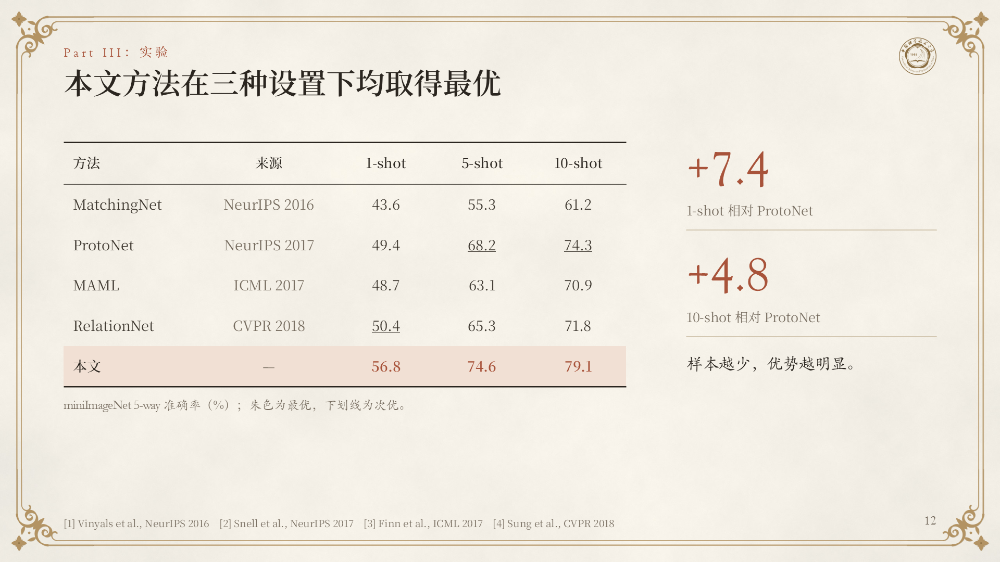

`compare_table(kicker, title, columns, rows, ours, best, second, note, stats, remark, muted=(), refs=None)`

- 三线表，3–6 列，数据行 ≤ 6，列宽按内容自动测量。
- `ours`：本文所在行（朱色底）；`best` / `second`：`{(行, 列)}`，分别显示为朱色粗体、下划线；`muted`：以次要色显示的列（如来源）。
- `stats`：右侧关键数字 ≤ 2 个，说明 ≤ 16 字；`remark` 结论句 ≤ 28 字；`note` 表注 ≤ 40 字。

### 8 图表分析

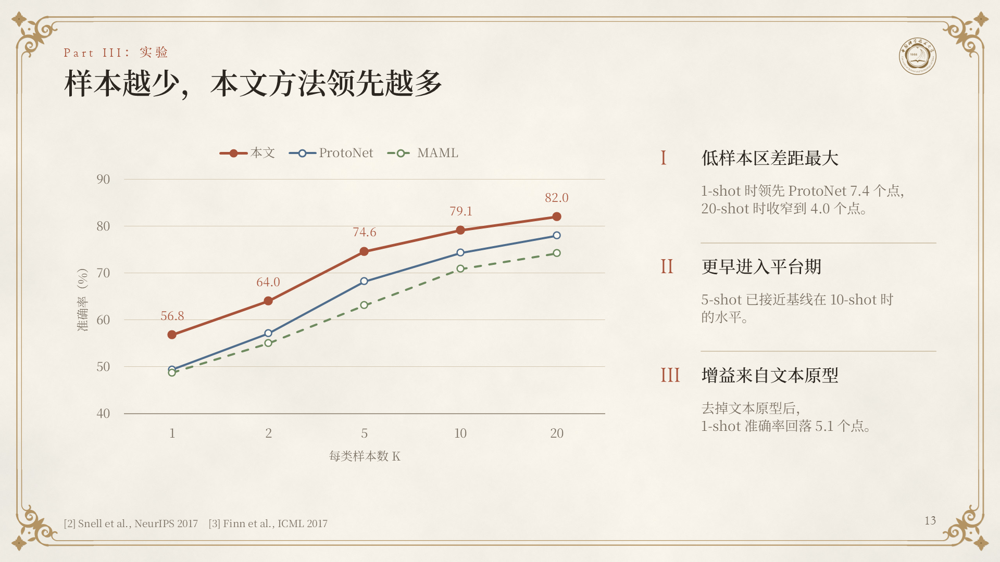

`chart_analysis(kicker, title, categories, series, points, x_title=None, y_title=None, y_range=(min, max, step), refs=None)`

- PowerPoint 原生折线图，可直接在 PowerPoint 里改数据。
- `categories` ≤ 8 个；`series` ≤ 4 条 `dict(name, values, color, width, dash, hollow, marker)`，第 1 条视为本文并带数值标签。
- `points`：≤ 3 条 `(小标题, 说明)`，小标题 ≤ 12 字，说明 ≤ 32 字。

### 9 多点论述

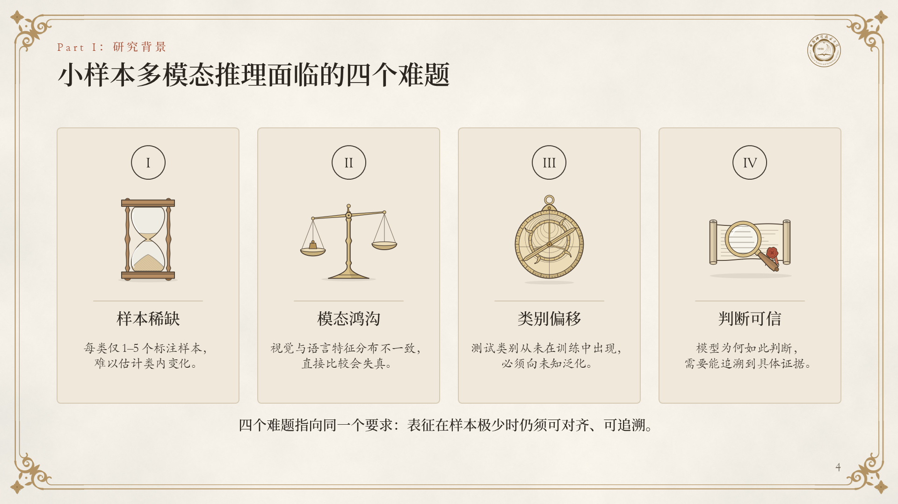

`cards(kicker, title, cards, takeaway=None, refs=None)`

- `cards`：3–4 张 `dict(art, title, text)`；`art` 选插画，`title` ≤ 8 字。
- `text`：4 张时 ≤ 24 字、3 张时 ≤ 34 字，中间放一个逗号以便对称断行。
- `takeaway`：底部结论句 ≤ 40 字。

### 10 总结结束

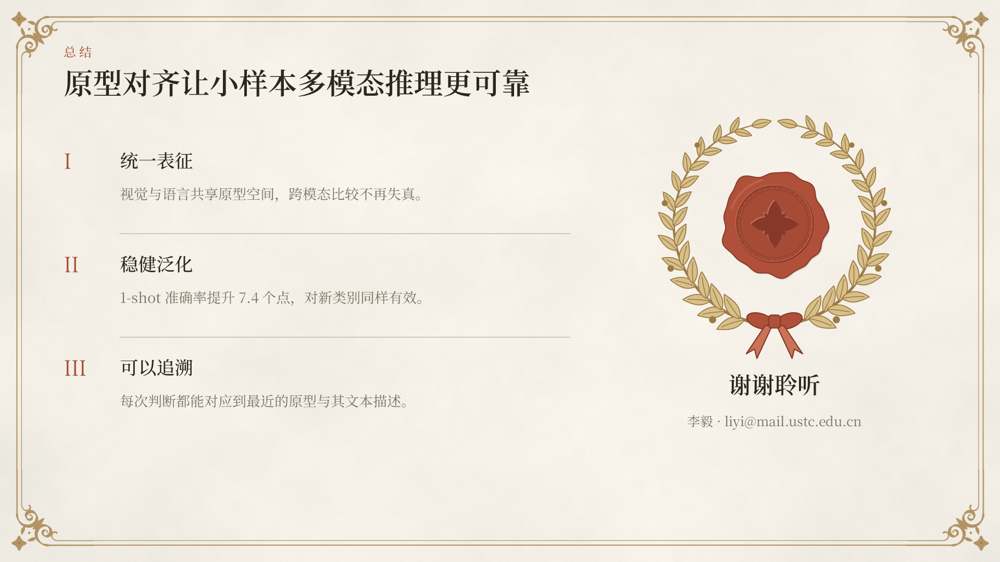

`closing(kicker, title, points, thanks, contact)`

- `points`：≤ 3 条 `(小标题, 说明)`，小标题 ≤ 12 字，说明 ≤ 30 字（一行）。
- `thanks` ≤ 6 字；`contact` 一行。

### 11 纯文本

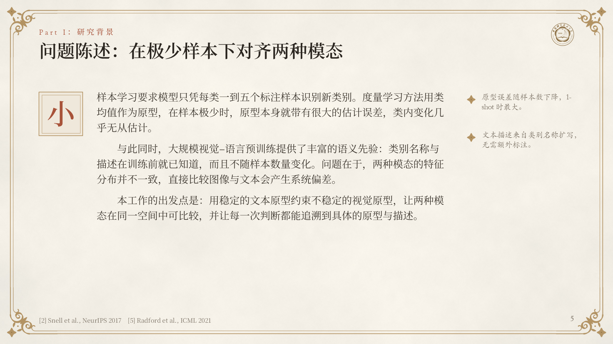

`text_page(kicker, title, paragraphs, notes=(), refs=None)`

- 唯一允许大段文字的正文页：首字放大（朱色，金框），两端对齐，段首缩进两字，自动避免段末孤字。
- `paragraphs`：2–4 段，有旁注时合计 ≤ 300 字，无旁注时 ≤ 420 字。
- `notes`：右侧旁注 ≤ 2 条，每条 ≤ 24 字。

### 12 时间轴

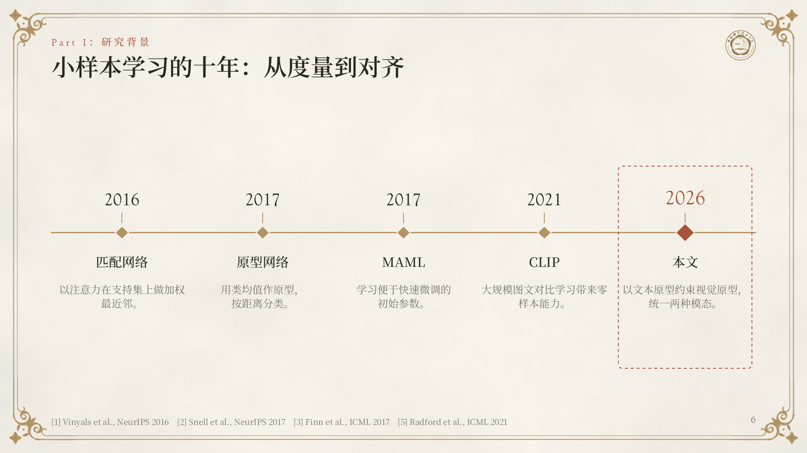

`timeline(kicker, title, events, refs=None)`

- `events`：4–6 个 `dict(date, title, text, key=False)`；`date` ≤ 6 个字符，`title` ≤ 6 字，`text` ≤ 24 字。
- `key=True` 标记本文：朱色节点 + 虚线框。

### 13 相关工作对比

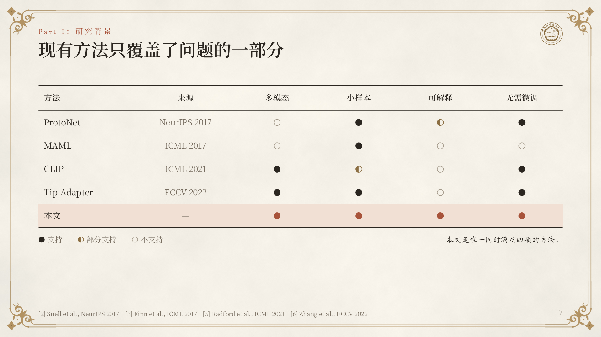

`related_work(kicker, title, columns, rows, ours, note, refs=None)`

- `columns`：方法、来源，再加 2–5 个特性列；`rows` ≤ 6 行。
- 特性格填 `'yes'` / `'part'` / `'no'`，显示为 ● / ◐ / ○（本文行的 ● 为朱色），图例自动生成。
- `note`：右下结论句 ≤ 30 字。

### 14 伪代码

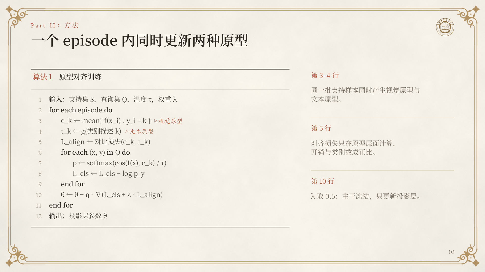

`pseudocode(kicker, title, caption, lines, notes, refs=None)`

- 仿 LaTeX algorithm 排版：顶线、算法标题、分隔线、行号、底线。
- `caption`：如 `算法 1　原型对齐训练`（以全角空格分隔编号与名称）。
- `lines`：≤ 13 行 `(缩进层级 0–3, 文本)`；`for / each / do / end / if / return` 与“输入 / 输出 / 返回”自动加粗，`▷` 之后为朱色注释。
- `notes`：≤ 3 条 `(行号范围, 说明)`，说明 ≤ 34 字。

### 15 图片展示

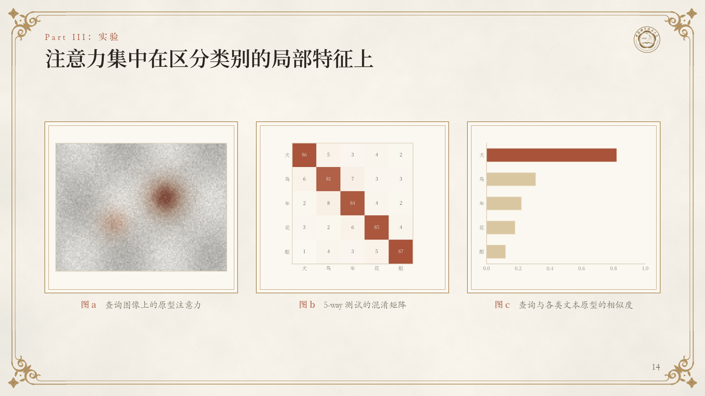

`gallery(kicker, title, images, refs=None)`

- `images`：1–3 张 `(图片路径, 图注)`，各自等比放入图版，图注自动编号为图 a / b / c；3 张时图注 ≤ 18 字。

### 16 参考文献

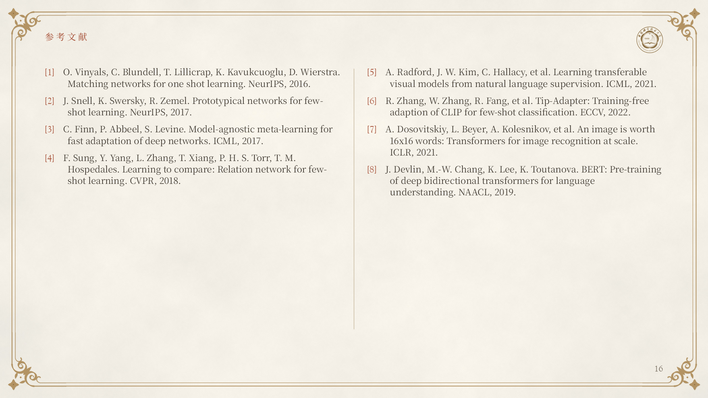

`references(entries, kicker='参考文献')`

- `entries`：完整引文字符串，自动编号并分两栏，≤ 12 条；超出时分成多页。

### 17 备用附录

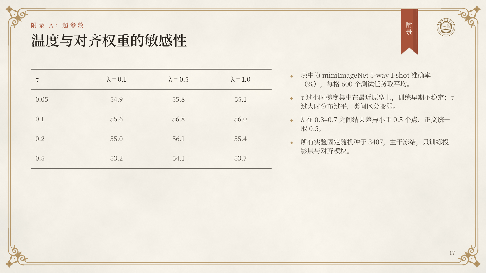

`appendix(tag, kicker, title, columns, rows, notes, refs=None)`

- 右上角朱色书签标出备用页，`tag` ≤ 3 字（竖排，如“附录”）。
- 左侧紧凑三线表（≤ 6 行、≤ 5 列），右侧要点 ≤ 5 条，每条 ≤ 50 字；允许比正文页更密的内容。

## 给 AI 的写作规则

1. **禁止无意义大段标题。** 标题写成一句结论，如“本文方法在三种设置下均取得最优”，而不是“实验结果”；章节信息放在眉题；不出现“目录 CONTENTS”“PART 01”“THANK YOU”之类的装饰大字。
2. **禁止大段文字。** 每个文字槽位都有上限（见上文）。只有纯文本页、参考文献页、备用附录页允许较长文字。
3. **禁止同一意思中英双语并列。** 固定文字只用一种语言；ProtoNet、5-way 这类术语可以出现，但不与译文并列。唯一例外是封面的英文标题。
4. **按内容选页。** 并列 3–4 个论点 → 多点论述；一张图配解读 → 图文双栏；多张图 → 图片展示；流程或框架 → 方法架构；核心公式 → 数学公式；算法步骤 → 伪代码；数值对比 → 实验对比；趋势 → 图表分析；发展脉络 → 时间轴；方法定位 → 相关工作对比；需要连贯论述 → 纯文本；问答备用材料 → 备用附录。
5. **引用。** 页面上引用了谁，就在该页 `refs` 写上简写，完整条目放进参考文献页，编号一致。

构建脚本会自动：在标点处断行并消除行尾孤字（`metrics.tidy`），两行文字尽量对称断开；纯文本页按段调整右缩进避免孤字；公式超宽时缩小；图片等比放入图版；表格列宽按内容分配。每个形状都有中文名（标题、眉题、卡片说明、参考文献……），方便在 PPT 的 XML 中定位替换。

## 设计系统

版面色板、字体角色与网格在 `codex/tokens.py`；插画用色在 `codex/illus.py` 顶部。换字体时还要在 `codex/metrics.py` 的 `FILES` 中登记字体文件，测宽与断行才准确。

### 色板

| 名称 | 色值 | 用途 |
|---|---|---|
| 羊皮纸 `PAPER` | `#F7F3EA` | 背景底色（实际背景为带斑驳与暗角的纹理图） |
| 卡片 `CARD` | `#EFE8DB` | 卡片、模块、公式底板 |
| 墨 `INK` | `#2B2620` | 标题 |
| 正文 `TEXT` | `#3E3830` | 正文 |
| 次要 `MUTED` | `#766C5F` | 说明、图注、参考文献 |
| 朱批 `RUBRIC` | `#A8533A` | 眉题、序号、最优数据、强调 |
| 金 `GILT` | `#B39363` | 边框、角花、分隔花纹、章节徽章 |
| 数据色 `SERIES` | `#A8533A` `#4F6D8C` `#6E8A5F` `#C2964B` `#86587A` `#8C8578` | 图表系列，依次为朱、青金、铜绿、赭、紫、灰 |

### 字体角色

每个文字片段都同时指定西文与中文字体，PowerPoint 按字符自动选用。

| 角色 | 西文 / 中文 | 用途 |
|---|---|---|
| `title` | Noto Serif SC SemiBold | 页面标题、封面标题 |
| `head` | Noto Serif SC Medium | 小标题、卡片标题 |
| `body` | Noto Serif SC | 正文 |
| `light` | Noto Serif SC Light | 细体文字（预留） |
| `kai` | Garamond / 华文楷体 | 图注、卡片说明、本章问题、旁注（中文语境下的“斜体”） |
| `kicker` | Goudy Old Style / Noto Serif SC Medium | 眉题，字距 3 pt |
| `num` | Goudy Old Style / Noto Serif SC | 罗马数字、大号数字、页码、封面英文标题 |
| `mono` | Cascadia Mono / Noto Sans SC | 代码（预留） |

公式用 Libertinus Math 排版。常用字号：封面标题 42、章节标题 32、页面标题 28、正文 13–16、图注 12–12.5、参考文献 9.5（单位 pt）。

### 版心网格

画布 13.333 × 7.5 英寸（16:9）。左右边距 0.85 英寸；眉题 y = 0.60，标题 y = 0.88，内容区 y = 1.85–6.42，底行 y = 6.86（左参考文献、右页码）。

### 版式（母版层）

边框、角花、校徽与页码放在版式里；页面上只有内容，以及随内容出现的插画和花饰（形状名带“装饰 ·”前缀）。

| 版式 | 内容 |
|---|---|
| 封面 | 边框与角花 |
| 正文 | 边框、右上角校徽、右下角页码 |
| 章节 | 边框与角花 |
| 结束 | 边框与角花 |

### 插画

`illus.py` 中的矢量插画，以 SVG 嵌入并附 PNG 兜底；多点论述页通过 `art` 字段选用：

`hourglass` 沙漏 · `scales` 天平 · `astrolabe` 星盘 · `magnifier` 放大镜与卷轴 · `armillary` 浑天仪（封面） · `laurel` 桂冠 · `seal` 火漆印

## 环境

| 依赖 | 用途 |
|---|---|
| Windows + PowerPoint | 渲染预览（`render.ps1`）；生成 PPTX 本身不需要 |
| Python 3（在 3.12 上测试）：`python-pptx` `resvg-py` `lxml` `numpy` `Pillow` `fonttools` `PyMuPDF` `matplotlib` | 构建；`matplotlib` 只用于 demo 的示例图 |
| TeX Live：`xelatex` `dvisvgm`，Libertinus 字体（完整安装自带） | 公式页与实验室标识 |
| 字体：Noto Serif SC（思源宋体，含 Light / Medium / SemiBold）、华文楷体、Goudy Old Style、Garamond、微软雅黑 Light | 后几种通常随 Windows / Office 安装；Noto Serif SC 需自行安装 |

```powershell
pip install python-pptx resvg-py lxml numpy pillow fonttools pymupdf matplotlib
```

## 目录结构

```text
PPT/
├─ build_demo.py        demo 构建脚本（17 种页型的完整示例）
├─ codex/               模板引擎
│  ├─ tokens.py         设计令牌：色板、字体角色、版心网格
│  ├─ pages.py          页型构建器 Codex，及四个版式（封面 / 正文 / 章节 / 结束）
│  ├─ pptkit.py         OOXML 底层：中西文分设字体的文本、形状、SVG 图片、三线表、原生图表
│  ├─ metrics.py        读取真实字体文件测宽；标点处断行、消除孤字
│  ├─ mathtex.py        LaTeX → 矢量 SVG（XeLaTeX，按内容缓存）
│  ├─ art.py            边框、涡卷角花、分隔花纹、八瓣花饰、书签
│  ├─ illus.py          铜版画风格插画
│  ├─ paper.py          羊皮纸底纹
│  ├─ logos.py          校徽 / 校名重新着色；实验室标识（按 LaTeX 模板的 \LabLogo 绘制）
│  └─ geom.py svg.py    几何与 SVG 工具
├─ tools/render.ps1     PowerPoint 渲染 PNG / PDF
├─ assets/cache/math/   公式与标识缓存（可删，构建时重建）
├─ demo/                demo 输出：pptx、pdf、preview/*.png
└─ logos/               校徽与校名（PDF 矢量）
```

## 扩展

- **新页型：** 在 `Codex` 中加方法。用 `self.page(kicker, title, refs)` 取页（自带页头与参考文献位），坐标取 `tokens.py` 的网格，文字用 `P` / `R`（`R` 的角色决定字体）。
- **新插画：** 在 `illus.py` 写一个返回 SVG 字符串的函数（240 × 240 视框，沿用 `INK` / `BRASS` 等配色与 `hatch()` 排线），再登记到 `pages.ILLUS`。
- **换学校标识：** 替换 `logos/ustc-badge.pdf` 与 `logos/ustc-name.pdf`（黑色单色矢量 PDF，不带填充色属性），颜色由 `logos.mark()` 重新着色；实验室标识在 `logos.py` 的 `LAB_TEX` 中。

## 已知限制

- Noto Serif SC 不是 Windows 自带字体，换电脑放映前需要安装，否则 PowerPoint 会替换字体；华文楷体、Goudy Old Style、Garamond 在没有 Office 字体的机器上同样缺失。
- PowerPoint 导出 PDF 时会整套嵌入思源宋体可变字体（约 30 MB），可用 PyMuPDF 子集化压缩：

  ```powershell
  python -c "import fitz; d = fitz.open('in.pdf'); d.subset_fonts(); d.save('out.pdf', garbage=4, deflate=True)"
  ```

- 目标 PPTX 正被其他程序打开时，构建会报 `PermissionError`，关闭文件后重试。
- demo 中的实验数据与结论为占位内容，不是真实实验结果；参考文献条目为真实论文。
